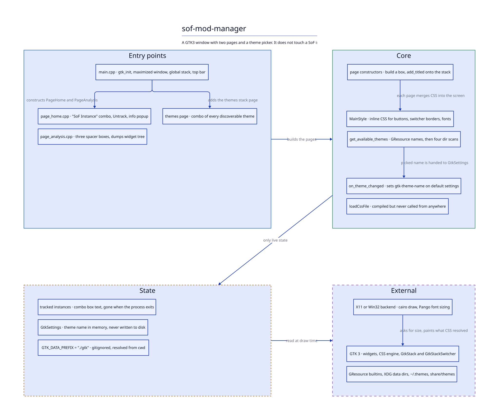

# sof-mod-manager

A GTK3 shell for managing Soldier of Fortune installs — right now it draws the window, the page switcher and a theme picker, and stops there.

Read it left to right:

- **Nothing is managed yet.** The README promises launch, edit and update of SoF addons; the code contains no file scanning, no checksums, no launch command, no pak or M32 tooling. The plan for all of that lives in a comment block at the top of `src/main.cpp` — the diagram shows what exists, not the plan.
- **"SoF Instance" tracks folders for one session only.** The combo box holds full paths and the "Untrack" button removes an entry, but the path list exists purely as widget text — there is no settings store, no config file, and closing the window loses the list. The info popup's "remembered for next time" is aspirational.
- **Two pages, both empty shells.** `page_home.cpp` builds the instance row and two unused horizontal boxes; `page_analysis.cpp` builds three spacer boxes and then dumps the widget tree to stdout. Real content was never written.
- **The theme picker is the only working feature, and it works properly.** `get_available_themes()` collects GTK's compiled-in themes from GResource, then scans `XDG_DATA_DIRS/themes`, `~/.local/share/themes`, `~/.themes` and `$GTK_DATA_PREFIX/share/themes` for a `gtk-3.0` subdirectory; `on_theme_changed` then sets `gtk-theme-name` on the default settings at runtime.
- **It expects a `./gtk` theme drop next to the binary.** `main()` sets `GTK_DATA_PREFIX=./gtk` before `gtk_init()` and starts on a theme called `hackerer-main`; that directory is gitignored (`/gtk/**`), so a fresh clone starts with the prefix pointing at nothing. The build itself is a MinGW i686 cross-compile to `mod_manager.exe` — `find_libs.sh` probes which GTK static libs can link.

Built with `makefile` (`i686-w64-mingw32-pkg-config gtk+-3.0`), run with `./run.sh` (`GTK_DEBUG=interactive` inspector).

Diagram source: [`docs/system.d2`](docs/system.d2) · renderer: [`scripts/render-diagram.sh`](scripts/render-diagram.sh).
